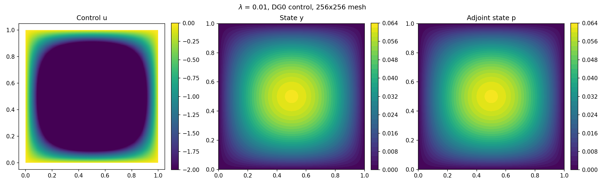
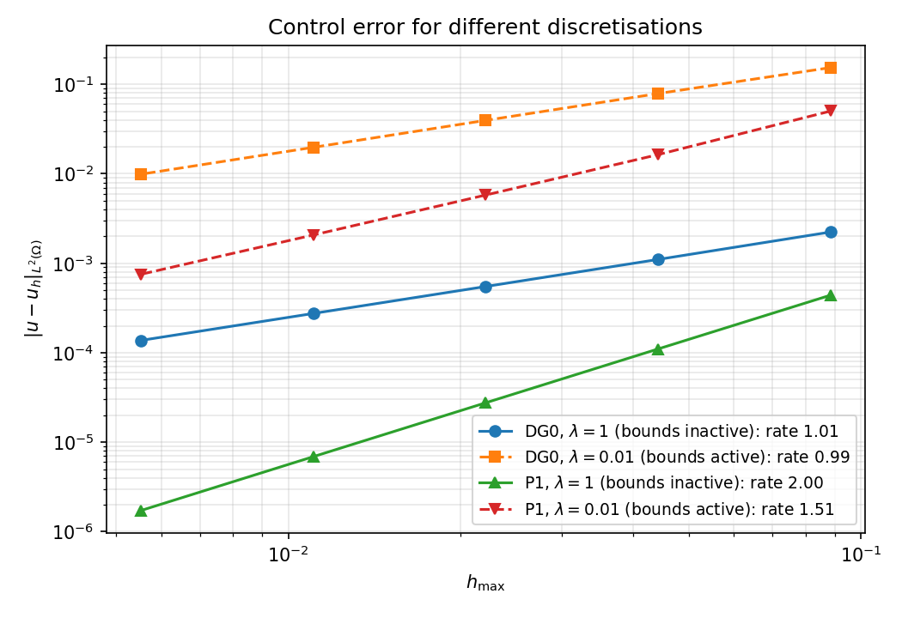

# Primal-dual active set strategy for optimal control of the advection–diffusion–reaction equation

Finite element solution of a PDE-constrained optimal control problem with box constraints on the control, using a primal-dual active set (PDAS) strategy in legacy FEniCS, and a comparison with the PDAS solver of [cashocs](https://github.com/sblauth/cashocs).

Bachelor's thesis in Mathematics, Bielefeld University, 2021 (supervisors: Dr. Tabea Tscherpel, Prof. Dr. Lars Diening). The thesis is in [`thesis/Bachelor-Chavarria.pdf`](thesis/Bachelor-Chavarria.pdf) (with corrected typos in Section 6.1, see note 4).

<p align="center">
  
</p>

## Problem

$$\min_{u \in U_{ad}} \; J(y, u) = \tfrac12 \|y - y_\Omega\|^2_{L^2(\Omega)} + \tfrac{\lambda}{2}\|u\|^2_{L^2(\Omega)}$$

subject to the stationary advection–diffusion–reaction (ADR) equation

$$-\varepsilon \Delta y + b \cdot \nabla y + \kappa y = u + g \;\; \text{in } \Omega = (0,1)^2, \qquad y = 0 \;\; \text{on } \partial\Omega,$$

and the box constraints $U_{ad} = \{u \in L^2(\Omega) : u_a \le u \le u_b \text{ a.e.}\}$, with $\varepsilon = \kappa = 1$, $b = (3, 4)$, $u_a = -2$, $u_b = 2$.

The first-order optimality system consists of the state equation, the adjoint equation $-\varepsilon\Delta p - b\cdot\nabla p + \kappa p = y - y_\Omega$, and the projection formula $u = \Pi_{[u_a, u_b]}(-p/\lambda)$. The data $y_\Omega$ and $g$ are manufactured so that the exact solution is $y = p = x_1 x_2 (1-x_1)(1-x_2)$.

## Method

- **Discretisation:** continuous P1 elements for state and adjoint; piecewise constant (DG0) or continuous P1 elements for the control.
- **PDAS:** for given active sets $\mathcal A_a = \{-p/\lambda < u_a\}$ and $\mathcal A_b = \{-p/\lambda > u_b\}$, the state, adjoint and control equations are solved together as **one** linear system (mixed formulation); the active sets are then updated until they no longer change.
- **Theory (thesis):** existence and uniqueness, optimality conditions, and the a priori estimates $\|u-u_h\|_{L^2} = O(h)$ and $\|y-y_h\|_{H^1}, \|p-p_h\|_{H^1} = O(h)$ for DG0 controls.

## Results

Running `scripts/run_convergence.py` reproduces Table 6.2 of the thesis exactly; `scripts/run_cashocs.py` reproduces Table 6.3 (cashocs). Beyond the thesis, the repository adds a test case with active bounds ($\lambda = 0.01$: a bound is active on about 60 % of the domain) and P1 controls:



| Control | Bounds | $\|u-u_h\|_{L^2}$ rate | $\|y-y_h\|_{H^1}$ rate | PDAS iterations |
|---|---|---|---|---|
| DG0 | inactive ($\lambda = 1$) | 1.00 | 1.00 | 2 |
| DG0 | active ($\lambda = 0.01$) | 0.99 | 1.00 | 2–3 |
| P1 | inactive ($\lambda = 1$) | 2.00 | 1.00 | 2 |
| P1 | active ($\lambda = 0.01$) | 1.51 | 1.02 | 2–3 |

The number of PDAS iterations does not grow with the mesh size (mesh independence).

### Notes added after the thesis

1. **Why cashocs converges with order 2 (open question in the thesis).** cashocs discretises the control with P1 elements. When the bounds are inactive, the discrete optimality condition gives $u_h = -p_h/\lambda$ exactly, so the control inherits the $O(h^2)$ $L^2$-convergence of the adjoint. The $O(h)$ estimate of the thesis is specific to DG0 controls, where $u_h$ is a cell average. Solving the same problem with P1 controls in our own implementation reproduces the cashocs errors to at least three significant digits. With active bounds the order drops to about $h^{3/2}$, due to the kinks of the control at the boundary of the active set.
2. **The thesis test problem never activates the bounds.** Since $-p/\lambda \in [-1/16, 0] \subset [-2, 2]$ for $\lambda = 1$, the box constraints are inactive, and PDAS terminates after two iterations. The case $\lambda = 0.01$ was added to test the active-set mechanism.
3. **Corrected sign in the active-set update.** The thesis code computed $\mu = p/\lambda - u$ instead of $\mu = -p/\lambda - u$ (equivalently $\mu = -\lambda^{-1} f'(u)$, as in Section 5.1 of the thesis). For the thesis test problem this has no effect, but with active bounds the original version stops at a wrong solution ($\|u - u_h\|_{L^2} \approx 3.2$ on every mesh). The corrected version is used here.
4. **Corrected thesis PDF.** The formulas for $y_\Omega$ and $g$ printed in Section 6.1 of the submitted thesis contained typos; the code always used the correct data, which were verified symbolically. The PDF in this repository was recompiled from the original LaTeX sources with these formulas corrected (marked by a footnote) and the student ID number removed from the title page; everything else is unchanged. In Tables 6.2–6.3, the column "NDOF" is the number of cells per side, and $h = 1/(2n)$ is proportional to, not equal to, the mesh size; the rates are unaffected. The tables here use $h_{\max}$.

## Future work

- [ ] Correct the remaining sign inconsistencies in the thesis text: the definition of $\mu$ in Section 5.1 and Algorithm 1 (it should read $\mu = -\lambda^{-1}p - u$), and the conditions for the upper bound in (5.1)–(5.3) ($>$ instead of $<$).
- [ ] Prove the equivalence between the optimality system and its mixed formulation (open point in the conclusions of the thesis).
- [ ] Error analysis for P1 controls and for variational discretisation / post-processing, which explains the observed orders $h^2$ (inactive bounds) and $h^{3/2}$ (active bounds).
- [ ] Convection-dominated case (small $\varepsilon$): stabilisation (e.g. SUPG or discontinuous Galerkin) and the second test problem of Leykekhman (2012), Section 5.1.
- [ ] Mesh independence of PDAS as a semismooth Newton method, tested on problems with larger active sets.
- [ ] Port from legacy FEniCS (no longer maintained) to FEniCSx, with an iterative solver and preconditioner for the saddle-point system on finer meshes.
- [ ] Regression tests based on the manufactured solution.

## Project structure

```
pdas-optimal-control/
├── src/pdas_adr/
│   ├── problem.py      # parameters and manufactured solution
│   ├── solver.py       # mixed formulation of the optimality system
│   ├── active_set.py   # indicator functions of the active sets, projection of p
│   ├── pdas.py         # PDAS loop and convergence study
│   └── plotting.py
├── scripts/
│   ├── run_convergence.py   # PDAS convergence study (--lam, --control)
│   ├── run_cashocs.py       # the same problem with cashocs 1.3
│   ├── compare_rates.py     # control errors of all configurations
│   └── _ufl_compat.py       # lets cashocs 1.3 run on Ubuntu's FEniCS packages
├── config/config_box.ini    # cashocs configuration
├── results/                 # error tables (CSV)
├── figures/
└── thesis/Bachelor-Chavarria.pdf
```

## Installation and usage

The code uses **legacy FEniCS (2019)** and, for the comparison, **cashocs 1.3** (later versions no longer include PDAS). Tested on Ubuntu 24.04 with Ubuntu's FEniCS packages:

```bash
sudo apt install python3-dolfin python3-matplotlib
pip install --break-system-packages "cashocs==1.3.4" deprecated   # only for run_cashocs.py

python3 scripts/run_convergence.py                          # thesis, Table 6.2 (~30 s)
python3 scripts/run_convergence.py --lam 0.01               # active bounds
python3 scripts/run_convergence.py --control P1             # P1 controls
python3 scripts/run_convergence.py --lam 0.01 --control P1
python3 scripts/compare_rates.py
python3 scripts/run_cashocs.py                              # thesis, Table 6.3
```

Alternatively, `environment.yml` describes a conda environment with FEniCS 2019.1 from conda-forge (not tested).

## References

- F. Tröltzsch (2010). *Optimal Control of Partial Differential Equations.* AMS.
- M. Hinze, R. Pinnau, M. Ulbrich, S. Ulbrich (2009). *Optimization with PDE Constraints.* Springer.
- K. Ito, K. Kunisch (2008). *Lagrange Multiplier Approach to Variational Problems and Applications.* SIAM.
- E. Casas, F. Tröltzsch (2003). Error estimates for linear-quadratic elliptic control problems.
- D. Leykekhman (2012). Investigation of commutative properties of discontinuous Galerkin methods in PDE constrained optimal control problems. *J. Sci. Comput.* 53(3).
- S. Blauth (2021). cashocs: A computational, adjoint-based shape optimization and optimal control software. *SoftwareX* 13.
- M. S. Alnæs et al. (2015). The FEniCS Project Version 1.5. *Archive of Numerical Software* 3.
